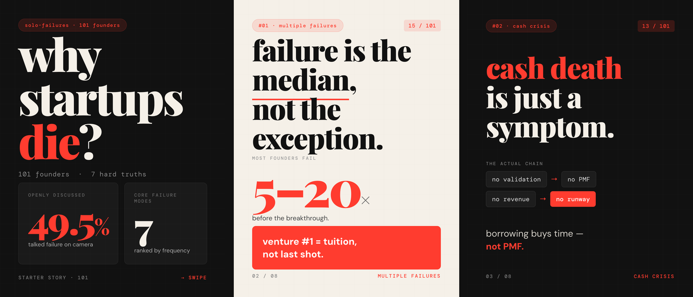

# Solo Founder Playbook

**6 startup skills for solo founders — informed by 183 analyzed [Starter Story](https://www.youtube.com/@starterstory) videos.**

A startup advisor in your terminal, grounded in a catalog of video summaries and recurring themes. The videos are selected founder stories, not a representative sample of startups; use the patterns as prompts for investigation, not predictions.

→ **Try it in 30 seconds, no install:** https://sfp.fyi/try



<sub>Three example cards from the original 101-video release. They are illustrative, not measured failure rates. [See all eight →](https://sfp.fyi/cards-en.html)</sub>

## Install

### Claude Code (recommended — plugin marketplace)

One step (Claude Code 2.1.275 or later):

```
/plugin install solo-founder-playbook --marketplace yayashuxue/solo-founder-playbook
```

Or in two steps, on any version with plugin support:

```
/plugin marketplace add yayashuxue/solo-founder-playbook
/plugin install solo-founder-playbook
```

All 6 skills become available immediately. No restart needed.

### OpenAI Codex (or fallback for Claude Code)

```bash
git clone --single-branch --depth 1 https://github.com/yayashuxue/solo-founder-playbook.git ~/.codex/skills/solo-founder-playbook && bash ~/.codex/skills/solo-founder-playbook/install-codex.sh
```

Restart Codex to pick up new skills.

### Update / Uninstall

**Update (plugin):** `/plugin update solo-founder-playbook` (Claude Code)
**Update (clone):** `cd ~/.codex/skills/solo-founder-playbook && git pull && bash install-codex.sh`
**Uninstall (plugin):** `/plugin uninstall solo-founder-playbook`
**Uninstall (clone):** `rm -rf ~/.codex/skills/solo-{analyze,failures,growth,patterns,playbook,roast} ~/.codex/skills/knowledge ~/.codex/skills/solo-founder-playbook`

## Skills

| Skill | What it does | Example |
|-------|-------------|---------|
| `/solo-analyze` | Evaluate your idea against the pattern catalog | `/solo-analyze a tool that helps devs find API docs faster` |
| `/solo-failures` | Failure-mode diagnosis using a historical subset of founder stories | `/solo-failures I've been in stealth 8 months with $15k savings left` |
| `/solo-growth` | Growth & marketing recommendations by business type | `/solo-growth I run a $2k MRR SaaS for freelancers` |
| `/solo-patterns` | Browse recurring themes across 11 categories | `/solo-patterns Marketing/Distribution` |
| `/solo-playbook` | Step-by-step playbook for any goal | `/solo-playbook how do I get my first 100 users?` |
| `/solo-roast` | Get your plan roasted — with data | `/solo-roast spend 6 months building before launch` |

## What's in the Data

The original catalog was generated by the **[Starter Story Pipeline](https://github.com/yayashuxue/starterstory-pipeline)**, a 5-step process that:

1. Pulls video URLs from a YouTube channel
2. Downloads transcripts
3. Categorizes each video into 11 startup topics
4. Summarizes and refines the raw analysis
5. Extracts cross-video patterns and keywords

The original release analyzed 101 videos. This refresh adds 82 analyses: 78 videos published after the original crawl and four older videos that were previously missed. The current dataset contains 183 analyzed videos and includes:

- **11 categories**: Idea Generation, Validation, Building, Launch, Marketing, Growth, Monetization, Challenges/Failures, Team, Costs, Advice
- Recurring patterns with approximate video mention counts and source video IDs
- Keywords and tools mentioned in the summaries
- A CSV of per-video summaries and a source-video index

Counts are approximate mentions across these videos, not rates of success or evidence that a tactic causes growth. The failure-mode catalog is a historical subset and has not been recounted for all 183 videos. See [the data notes](knowledge/DATA.md) for collection and verification details.

Want to run the pipeline yourself or adapt it for a different channel? Check out the **[pipeline repo](https://github.com/yayashuxue/starterstory-pipeline)**.

## Project Structure

```
.claude-plugin/
  marketplace.json                # Claude Code plugin marketplace entry
  plugin.json                     # plugin manifest
knowledge/                        # single source of truth (shared by 5 skills)
  patterns.json
  insights.md
  source-videos.json
  video-summaries.csv
  DATA.md
skills/
  solo-analyze/SKILL.md
    knowledge -> ../../knowledge  # symlink
  solo-growth/SKILL.md
    knowledge -> ../../knowledge
  solo-patterns/SKILL.md
    knowledge -> ../../knowledge
  solo-playbook/SKILL.md
    knowledge -> ../../knowledge
  solo-roast/SKILL.md
    knowledge -> ../../knowledge
  solo-failures/                  # self-contained (own knowledge bundle)
    SKILL.md
    knowledge/
      failure-modes.md
      patterns.json
      insights.md
      source-videos.json
install.sh                        # Claude (clone fallback) installer
install-codex.sh                  # Codex installer
```

## Try in Browser First

Don't want to install yet? https://sfp.fyi/try lets you pick a skill, paste your situation, and send a short preview prompt to ChatGPT or copy it for another chat. The browser prompt links to public context; it does not include the full pattern catalog. Install the skills to use the bundled data.

If a skill saved you from a bad call, a ⭐ helps other founders find it.

## License

MIT
